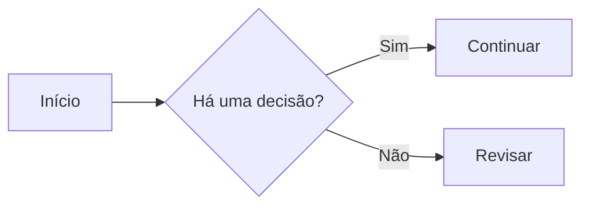

> **Publicação de demonstração.** Este artigo traduz e adapta o texto introdutório do StackEdit enviado para testar a apresentação editorial do GeanRamos V2. Os exemplos visuais e o vídeo foram acrescentados para avaliar o tema.

# Bem-vindo ao StackEdit!

Este é seu primeiro arquivo Markdown no **StackEdit**. Para conhecer a ferramenta, leia este guia. Se quiser experimentar, edite o documento. Quando terminar, você poderá criar novos arquivos pelo **explorador de arquivos**, no canto esquerdo da barra de navegação.

## Arquivos

O StackEdit guarda seus arquivos no navegador. Isso significa que eles são salvos automaticamente em seu dispositivo e podem ser acessados **mesmo sem conexão com a internet**.

### Criar arquivos e pastas

Abra o explorador de arquivos pelo botão no canto esquerdo da barra de navegação. Use **Novo arquivo** para criar um documento e **Nova pasta** para organizar seus textos.

### Alternar entre arquivos

Seus arquivos e pastas aparecem como uma árvore no explorador. Basta escolher outro documento para abri-lo.

### Renomear um arquivo

Clique no nome do arquivo na barra de navegação ou selecione **Renomear** no explorador.

### Excluir um arquivo

Use **Remover** no explorador. O arquivo será enviado para a **Lixeira** e excluído automaticamente após sete dias de inatividade.

### Exportar um arquivo

Selecione **Exportar para o disco**. É possível exportar em Markdown simples, HTML por meio de um modelo Handlebars ou PDF.

## Sincronização

O StackEdit permite sincronizar documentos com **Google Drive**, **Dropbox** e **GitHub**, facilitando a edição em diferentes dispositivos.

Há dois tipos de sincronização, que podem ser usados juntos:

- **Sincronização do espaço de trabalho:** mantém arquivos, pastas e configurações sincronizados automaticamente. Para ativá-la, entre com sua conta Google no menu.
- **Sincronização de arquivo:** mantém um documento específico sincronizado com um ou mais arquivos armazenados no Google Drive, Dropbox ou GitHub. Antes de usá-la, conecte uma conta no submenu **Sincronizar**.

### Abrir um arquivo

No submenu **Sincronizar**, clique em **Abrir de** e escolha Google Drive, Dropbox ou GitHub.

### Salvar um arquivo

Use **Salvar em** no submenu **Sincronizar** para enviar o documento a um serviço conectado. Mesmo que ele já esteja sincronizado com um destino, você pode adicioná-lo a outro.

### Sincronizar um arquivo

Depois de vinculado a um destino, o arquivo será sincronizado periodicamente. O StackEdit verifica alterações, faz a mesclagem e procura resolver conflitos.

Se quiser antecipar a operação, clique em **Sincronizar agora** na barra de navegação.

> **Observação:** o botão **Sincronizar agora** fica desativado quando nenhum arquivo está configurado para sincronização.

### Gerenciar a sincronização

Em **Sincronização de arquivo**, dentro do submenu **Sincronizar**, você pode ver e remover os destinos vinculados ao documento.

## Publicação

O StackEdit pode publicar seus arquivos em serviços como **Blogger, Dropbox, Gist, GitHub, Google Drive, WordPress e Zendesk**. Com os modelos Handlebars, você também controla a apresentação do HTML exportado.

Antes de publicar, conecte uma conta no submenu **Publicar**.

### Publicar um arquivo

Escolha **Publicar em**. Dependendo do serviço, você poderá publicar em:

1. **Markdown:** o texto original, destinado a sites que interpretam essa linguagem, como o GitHub.
2. **HTML:** uma versão convertida do arquivo, com um modelo Handlebars.

### Atualizar uma publicação

Depois da primeira publicação, o StackEdit mantém o vínculo com o destino. Para atualizar o conteúdo, use **Publicar agora** na barra de navegação.

> O botão **Publicar agora** fica desativado quando o arquivo ainda não foi publicado.

### Gerenciar publicações

Em **Publicação de arquivo**, você pode consultar e remover os destinos vinculados ao documento.

## Extensões do Markdown

O StackEdit oferece extensões que ampliam os recursos do Markdown.

**Dica:** você pode desativar extensões na janela **Propriedades do arquivo**.

### SmartyPants

O SmartyPants substitui determinados sinais ASCII por caracteres tipográficos apropriados, incluindo aspas curvas e travessões.

| Entrada ASCII | Resultado esperado |
| :-- | :-- |
| Aspas simples retas | Aspas simples tipográficas |
| Aspas duplas retas | Aspas duplas tipográficas |
| Hífens repetidos | Traços tipográficos |

### KaTeX

Com o [KaTeX](https://khan.github.io/KaTeX/), você pode apresentar expressões matemáticas. Um exemplo citado no documento original é a função gama:

<div class="math-display" data-tex="\Gamma(z) = \int_0^\infty t^{z-1}e^{-t}\,dt"></div>

E uma expressão no meio do texto: \(E = mc^2\).

**Suporte ativo:** o KaTeX agora renderiza as fórmulas matemáticas. Trechos dentro de blocos de código continuam sendo mostrados como código.

### Diagramas com Mermaid

O [Mermaid](https://mermaid.js.org/) cria diagramas a partir de texto. Exemplo de fluxograma:



**Nota técnica:** o bloco é exibido como código até que o suporte a diagramas seja instalado no blog.

## Laboratório de tipografia do GeanRamos V2

A seguir, três amostras extras para avaliarmos o contraste, a largura e a leitura em cada tema.

<div class="type-demo">
  <div class="type-sample type-sans"><span class="type-label">01 · Google Sans Flex</span><p class="type-headline">Ideias que merecem ser lidas.</p><p>A tecnologia muda depressa, mas um bom texto continua precisando de ritmo, clareza e espaço para respirar. Esta é a tipografia principal do blog.</p></div>
  <div class="type-sample type-serif"><span class="type-label">02 · Georgia, serifada</span><p class="type-headline">Histórias com um toque de revista.</p><p>As serifas dão outra personalidade às reflexões mais longas. Compare a forma das letras e a sensação durante a leitura.</p></div>
  <div class="type-sample type-mono"><span class="type-label">03 · Monoespaçada</span><p class="type-headline">Código, notas e experimentos.</p><p>Uma fonte monoespaçada destaca trechos técnicos, comandos e exemplos, mas não precisa dominar os artigos inteiros.</p></div>
</div>

### Teste de detalhes editoriais

Aqui temos **negrito**, *itálico*, ~~texto riscado~~, [um link de exemplo](https://stackedit.io/) e o comando `git status`.

> Um texto agradável não depende apenas da fonte: espaçamento, cor, tamanho e largura de coluna trabalham juntos.

## Vídeo incorporado do YouTube

Abaixo está o vídeo indicado para testar a incorporação responsiva. Ele começa em **3h48min55s**, o ponto correspondente a 13.735 segundos.

<div class="video-embed">
  <iframe src="https://www.youtube-nocookie.com/embed/4c7pbOxYn_A?start=13735" title="Vídeo do YouTube para demonstração de mídia incorporada" loading="lazy" referrerpolicy="strict-origin-when-cross-origin" allow="accelerometer; autoplay; clipboard-write; encrypted-media; gyroscope; picture-in-picture; web-share" allowfullscreen></iframe>
</div>

Este artigo é um teste visual e editorial. A tradução segue a organização do guia introdutório enviado; as amostras tipográficas, observações de compatibilidade e o vídeo são complementos feitos para o GeanRamos V2.

---

## Catálogo visual completo do tema

Esta seção é um **laboratório de componentes** para conferir proporções, espaçamento, contraste, responsividade e acessibilidade nos temas Claro, Escuro e Marrom. O texto abaixo é demonstrativo.

### Hierarquia de títulos H1 a H6

<div class="showcase-headings">
  <h1>H1 · Título principal de uma publicação</h1>
  <h2>H2 · Título de uma seção</h2>
  <h3>H3 · Título de uma subseção</h3>
  <h4>H4 · Quarto nível de título</h4>
  <h5>H5 · Quinto nível de título</h5>
  <h6>H6 · Sexto nível de título</h6>
</div>

> **Nota:** um artigo real normalmente deve ter apenas um H1 principal. Os títulos adicionais acima servem somente para o teste visual.

### Texto, ênfases e links

Este é um **parágrafo de texto normal** com largura de leitura confortável, acentuação brasileira e pontuação. Aqui aparecem **texto em negrito**, *texto em itálico*, ***negrito e itálico***, ~~texto riscado~~, <mark>texto marcado</mark>, <small>texto pequeno</small>, H<sub>2</sub>O e x<sup>2</sup>.

Um [link dentro do texto](https://geanramos.com/) deve ser reconhecível mesmo sem passar o mouse. Uma URL extensa também deve quebrar corretamente em telas estreitas.

### Listas não numeradas

- Um item de lista simples.
- Outro item para testar o espaçamento.
  - Subitem com recuo.
  - Segundo subitem.
- Último item da lista.

### Listas numeradas

1. Planejar a estrutura do conteúdo.
2. Escrever com clareza.
3. Revisar no celular e no computador.
   1. Conferir links.
   2. Conferir imagens e mídias.

### Lista de tarefas

- [x] Criar a V2.
- [x] Adicionar o KaTeX.
- [ ] Conferir cada componente visual.

### Citações

> Uma boa interface não precisa disputar a atenção com o conteúdo. Ela precisa deixar o conteúdo respirar.
>
> **Citação com segundo parágrafo:** contraste, largura da coluna e espaçamento fazem toda a diferença.

### Separador horizontal

---

### Código inline e blocos de código

Para atualizar o blog, um comando de exemplo é `bundle exec jekyll build`. Abaixo, um bloco de código com várias linhas:

```javascript
function saudar(nome) {
  const agora = new Date();
  return `Olá, ${nome}! São ${agora.getHours()} horas.`;
}
console.log(saudar('Gean'));
```

```bash
# Exemplo de terminal
npm run css:build
bundle exec jekyll build
```

### Tabela com alinhamentos

| Componente | Desktop | Celular |
| :--- | :---: | ---: |
| Conteúdo | 664 px | Fluido |
| Vídeo | 100% da coluna | 100% |
| Imagens | Responsivas | Responsivas |
| Botões | Em linha | Com quebra |

### Botões e estados

<div class="showcase-actions">
  <a class="showcase-btn showcase-primary" href="/arquivo/">Botão principal</a>
  <a class="showcase-btn showcase-secondary" href="/sobre/">Botão secundário</a>
  <a class="showcase-btn showcase-ghost" href="/contato/">Botão discreto</a>
  <button type="button" class="showcase-btn showcase-secondary" disabled>Desativado</button>
</div>

### Campos e formulário de demonstração

<div class="showcase-fields">
  <label for="demo-nome">Nome</label>
  <input id="demo-nome" type="text" placeholder="Seu nome" autocomplete="off">
  <label for="demo-assunto">Assunto</label>
  <select id="demo-assunto"><option>Escolha uma opção</option><option>Design</option><option>Tecnologia</option></select>
  <label for="demo-mensagem">Mensagem</label>
  <textarea id="demo-mensagem" rows="3" placeholder="Exemplo de campo de texto"></textarea>
  <p class="showcase-note">Estes campos são apenas para avaliação visual e não enviam dados.</p>
</div>

### Imagens e legendas

<figure class="showcase-figure">
  
  <figcaption>Imagem do próprio repositório, com legenda e texto alternativo.</figcaption>
</figure>

<div class="showcase-gallery">
  <figure><figcaption>Primeira imagem</figcaption></figure>
  <figure><figcaption>Segunda imagem</figcaption></figure>
</div>

### Fórmulas matemáticas com KaTeX

Uma expressão inline, \(a^2+b^2=c^2\), e uma fórmula destacada:

<div class="math-display" data-tex="\frac{-b \pm \sqrt{b^2 - 4ac}}{2a}"></div>

A função gama também aparece mais acima neste artigo.

### Vídeo do YouTube em 100% da largura disponível

O player abaixo ocupa **100% da coluna do artigo**, respeitando o formato 16:9, também no celular.

<div class="video-embed">
  <iframe src="https://www.youtube-nocookie.com/embed/4c7pbOxYn_A?start=13735" title="Vídeo incorporado em largura total para teste responsivo" loading="lazy" referrerpolicy="strict-origin-when-cross-origin" allow="accelerometer; autoplay; clipboard-write; encrypted-media; gyroscope; picture-in-picture; web-share" allowfullscreen></iframe>
</div>

### Outros elementos editoriais

<details class="showcase-details"><summary>Clique para expandir este conteúdo</summary><p>Um painel expansível, útil para perguntas frequentes e notas técnicas adicionais.</p></details>

<aside class="showcase-aside"><strong>Nota lateral:</strong> informações complementares podem ser destacadas sem interromper o artigo.</aside>

A demonstração termina aqui. Os componentes usam as mesmas variáveis de cor dos três temas do GeanRamos V2.
